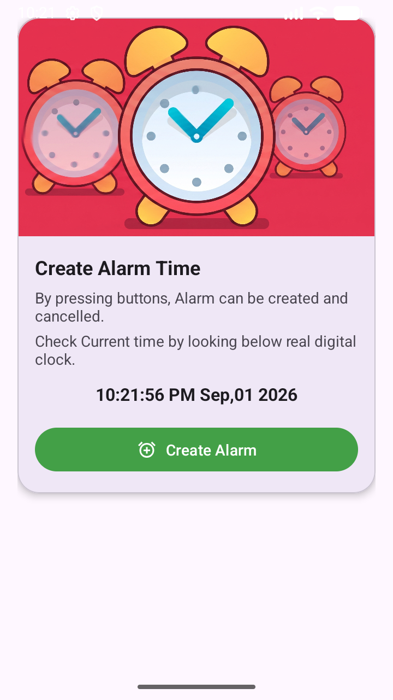
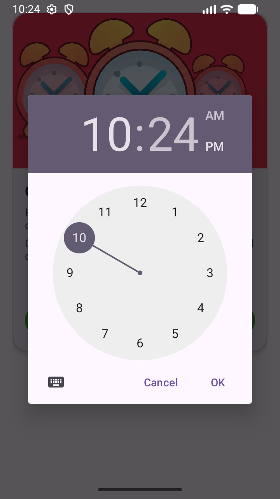
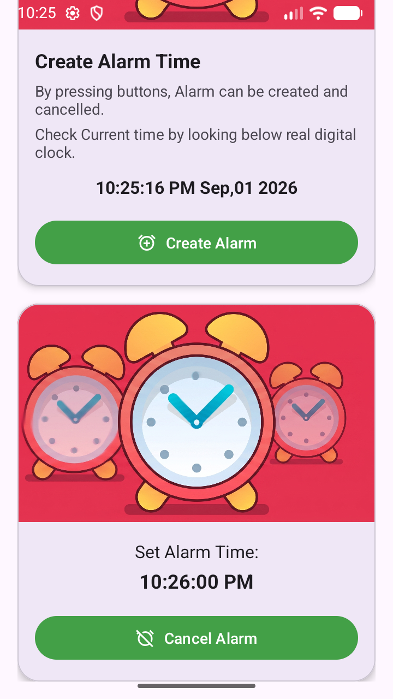
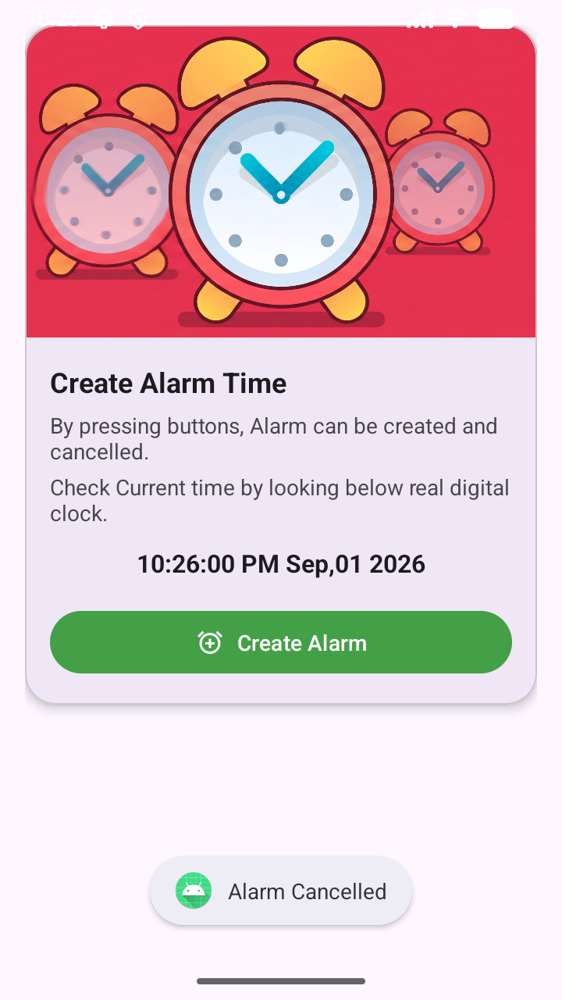

# Android Alarm Application

A robust Android Alarm Clock application built using core Android background processing components. This project demonstrates how to schedule precise alarms, handle background audio playback, and build a modern user interface using Material Design.

### Screenshots

<div align="center">
  
  
  
  
</div>

## 🚀 Features

- **Real-time Clock Display:** Live time tracking using the `TextClock` widget.
- **Interactive Time Selection:** Intuitive time picking using `TimePickerDialog`.
- **Precise Alarm Scheduling:** Reliable alarm triggering using `AlarmManager` and exact alarm permissions.
- **Background Audio Playback:** Seamless alarm ringtone playback managed via an Android `Service` and `MediaPlayer`.
- **Modern UI:** Clean, card-based interface built with `MaterialCardView`.

## 🏗️ Architecture & Core Components

This application relies on three primary components to ensure the alarm triggers accurately even if the app is closed:

1. **`MainActivity`:** Handles the user interface, displays the current time, opens the time picker, and sets the alarm via `AlarmManager`.
2. **`AlarmBroadcastReceiver`:** A `BroadcastReceiver` that listens for the specific time trigger from the `AlarmManager`. Once triggered, it wakes up the app and launches the service.
3. **`AlarmService`:** A background `Service` responsible for initializing the `MediaPlayer` and playing the alarm sound. 

## 📚 Key Concepts Demonstrated

This project serves as a comprehensive study of the following Android concepts and classes:

- **Background Processing:** `Service`, `BroadcastReceiver`, `startService()`, `stopService()`
- **System Services:** `AlarmManager`, `getSystemService()`, `sendBroadcast()`
- **Intents & Data Passing:** `PendingIntent`, `Intent.putExtra()`, `Intent.getStringExtra()`
- **Time & Date Management:** `Calendar`, `SimpleDateFormat`, `TimePickerDialog`
- **Media:** `MediaPlayer`
- **UI Components:** `TextClock`, `MaterialCardView`

## ⚙️ Prerequisites & Permissions

### Manifest Requirements
To ensure the `AlarmManager` can fire at the exact specified time on Android 12 (API level 31) and higher, the application requires the exact alarm permission.

Ensure the following permission is declared in your `AndroidManifest.xml`:
```xml
<uses-permission android:name="android.permission.SCHEDULE_EXACT_ALARM" />
